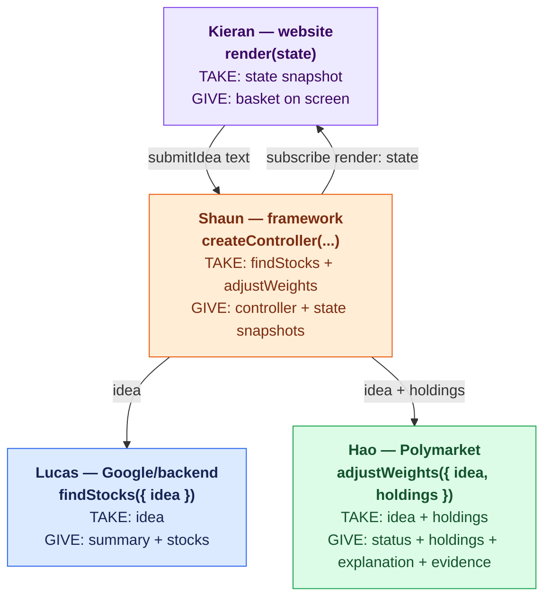

# MyETF teammate handoff

Team colors: **🟠 Shaun — framework**, **🟣 Kieran — website**,
**🟢 Hao — Polymarket**, and **🔵 Lucas — Google/backend**.

The teammate implementation files listed below are intentionally empty. Fill
them with your code. Shaun's controller, mock services, fixtures, and framework
tests are ready to use. The earlier agent prototype, its tests, and the previous
website were backed up locally before these files were emptied.

This guide describes the root application's starter files. Additional backend
implementations already exist on `main` under `web/` and `backend/src/`.

## Functions: what each person takes and gives

| Owner | Function to implement or provide | TAKE: input | GIVE: output |
| --- | --- | --- | --- |
| 🔵 **Lucas** | **`findStocks({ idea })`** | User's `idea` string | **`{ summary, stocks: [{ symbol, name }] }`** |
| 🟢 **Hao** | **`adjustWeights({ idea, holdings })`** | User's idea and selected `{ symbol, weightPct }` holdings | **`{ status, holdings, explanation, evidence }`** |
| 🟣 **Kieran** | **`render(state)`** in `js/ui.js` | Controller snapshots, including `stocks`, current `holdings`, `status`, and `error` | **Updated website DOM** showing names, tickers, percentages, loading, or errors |
| 🟠 **Shaun** | **`createController({ findStocks, adjustWeights })`**, already implemented | Lucas's and Hao's async functions | **Controller methods and state snapshots** for Kieran |

Kieran sends the user's idea through **`controller.submitIdea(text)`** and
receives updated snapshots through **`controller.subscribe(render)`**.
Both service functions also accept an optional second argument **`{ signal }`**.



## File ownership

All paths below are relative to the repository root (`app/` on Shaun's computer).

| Owner | Empty file | Put this code here |
| --- | --- | --- |
| 🔵 Lucas — Google/backend | `agent/gemini.js` | One Gemini agent with retrieval, tools, and memory; export `findStocks` |
| 🔵 Lucas — Google/backend | `agent/tools.js` | Tool declarations, argument checks, and tool execution |
| 🔵 Lucas — Google/backend | `agent/retrieval.js` | Retrieve project context for the agent |
| 🔵 Lucas — Google/backend | `agent/project-notes.json` | Valid JSON containing project context and output rules |
| 🔵 Lucas — Google/backend | `agent/memory.js` | Session-scoped preferences and previous baskets |
| 🔵 Lucas — Google/backend | `agent/basket.js` | Optional helper for an initial display basket; reuse `startingWeights` from `js/controller.js` |
| 🔵 Lucas — Google/backend | `agent/run.js` | Optional local CLI for trying the agent |
| 🔵 Lucas — Google/backend | `backend/server.js` | HTTP server exposing both API routes below |
| 🔵 Lucas — Google/backend | `js/stock-api.js` | Browser `findStocks` adapter calling `POST /api/stocks` |
| 🟢 Hao — Polymarket | `polymarket/weights.js` | Market lookup and weighting formula; export `adjustWeights` |
| 🟢 Hao — Polymarket | `js/weights-api.js` | Browser `adjustWeights` adapter calling `POST /api/weights` |
| 🟣 Kieran — website | `index.html` | Chat intake and basket dashboard markup |
| 🟣 Kieran — website | `css/styles.css` | Website styling and responsive layout |
| 🟣 Kieran — website | `js/ui.js` | Render controller snapshots; show names, tickers, and percentages |
| 🟣 Kieran — website | `js/app.js` | Connect UI events, controller, and both API adapters |
| 🟣 Kieran — website | `js/config.js` | Export `API_BASE_URL`, provided by Lucas |

Keep the shared `js/controller.js`, `js/services.js`, and `data/chat-demo.json`
available. Coordinate any changes to these shared contracts with Shaun.

## 🔵 Lucas — Google/backend: take an idea, give selected companies

**FUNCTION TO EXPORT: `findStocks({ idea }, { signal } = {})`**

**TAKE:** `{ idea: string }`.

**GIVE:** `{ summary: string, stocks: [{ symbol: string, name: string }] }`.

Implement the server-side function in `agent/gemini.js`:

```js
export async function findStocks({ idea }, { signal } = {}) { /* your code */ }
```

Expose it through `POST /api/stocks` in `backend/server.js`.

Request body:

```json
{ "idea": "I care about clean energy" }
```

Response body:

```json
{
  "summary": "Your clean energy basket",
  "stocks": [
    { "symbol": "AAA", "name": "Company A" },
    { "symbol": "BBB", "name": "Company B" },
    { "symbol": "CCC", "name": "Company C" }
  ]
}
```

The names and tickers are placeholders. Find three actual companies with unique
symbols. Use a short summary; return no `reason` or `research` fields. Keep Google
credentials on the backend. `agent/.env.example` remains a configuration template;
local `.env` files are ignored by Git. Provide Kieran with the
backend base URL and configure CORS for the website origin.

The browser adapter in `js/stock-api.js` must export the same `findStocks`
signature, send `{ idea }` to the endpoint, forward `signal` to `fetch`, and
return the response JSON. Reject failures instead of substituting demo companies.

The shared controller assigns equal starting weights: 33.33%, 33.33%, 33.34%.
An additional `basket` field is optional; the controller uses `summary` and
`stocks`, so those fields must remain available.

**When the idea needs clarifying (added 2026-10-10).** `findStocks` can reject
instead of returning a basket: the idea is nonsense, unrelated to investing, a
broad everyday word ("car"), or about companies we do not cover (carmakers,
airlines). The success shape above does not change.

- `POST /api/stocks` answers `422`:
  `{ "error": { "code": "needs_clarification", "message": "<question>", "options": ["<idea>", "<idea>", "<idea>"] } }`
- `js/stock-api.js` rejects with an `Error` whose `message` is the question,
  with `error.code === "needs_clarification"` and `error.options` (2 or 3 strings).
- Each option is a complete idea. When the person picks one, call
  `findStocks({ idea: option })` again (through the controller: `submitIdea(option)`).
- On a clarification nothing is saved to memory and no weights or votes should be
  requested. Every other rejection also keeps `error.code` (for example
  `gemini_unavailable`) and has no `options`.

```js
try {
  const selection = await findStocks({ idea }, { signal });
} catch (error) {
  if (error.code === "needs_clarification") {
    // show error.message as the question and one button per error.options entry (as text)
  }
}
```

## 🟢 Hao — Polymarket: take selected holdings, give their weights and evidence

**Already live; nothing to rebuild.** `POST https://prophetf.vercel.app/api/weights` implements
`adjustWeights` (TypeScript in `web/`, checked against the Python reference in `backend/`).
The browser adapter is ready in `js/weights-adapter.js`, and `js/weights-api.js` re-exports it,
with the same signature as below (`adjustWeights({ idea, holdings }, { signal })`). The server
side lives in `web/src/lib/weights/`, so `polymarket/weights.js` stays a pointer.
Full contract: `web/docs/API.md` section 2.

**FUNCTION: `adjustWeights({ idea, holdings }, { signal } = {})`**

**TAKE:** `{ idea: string, holdings: [{ symbol: string, weightPct: number }] }`.

**GIVE:** `{ status: "adjusted" | "unchanged", holdings, explanation, evidence }`.

### How it works

- The backend tracks a fixed list of 11 Polymarket markets (Fed cuts, US recession, Taiwan,
  Ukraine ceasefire, Bitcoin $100k, …). On each request it looks each one up live on
  Polymarket (cached 60 seconds), so probabilities are current.
- Each market has a hand-set sensitivity per stock for the 40 tickers `findStocks` can return
  (e.g. TLT rises if recession odds rise). A holding's weight tilts by how much its linked
  markets moved over the past week. A holding no market is linked to keeps its weight relative
  to the others.
- `status: "unchanged"` (original weights) when no live market is linked (`evidence: []`) or
  the tilt rounds away. Errors come back as `{ "error": { "code", "message" } }`; the adapter
  turns them into a rejected promise and the controller keeps equal weights.

### Evidence items

```json
{
  "title": "Will AI-chip export licensing become law this year?",
  "url": "https://polymarket.com/event/which-bills-will-become-law-in-2026",
  "outcome": "Yes",
  "probability": 0.225,
  "observedAt": "2026-10-10T01:16:16.000Z",
  "change7d": -0.125,
  "symbols": ["INTC", "NVDA"]
}
```

`probability` and `change7d` are 0–1 (multiply by 100 for % and pts); `symbols` are the
basket's tickers this market moves; `observedAt` is when the odds were read.

### Event risk (`POST /api/risk`, live once PR #15 is merged)

Same body as `/api/weights`. For each linked market: `ifYesPct` (basket move if the event
happens) and `ifNoPct` (if it doesn't), the `drivers` behind it, plus `uncovered` symbols and
two caveat strings, `basis` and `note`. Contract: `web/docs/API.md` section 2b.

### On screen (🟣 Kieran)

The evidence is what makes the basket credible to finance judges, so show it under the basket:

1. **Why these weights:** the `explanation` text.
2. **One card per evidence item:** the market question as a link to `url`; "Yes 22.5%"; the
   7-day move ("▼ 12.5 pts this week" from `change7d`); the affected tickers; "as of" `observedAt`.
3. **Event risk on the same card** (once `/api/risk` is live): "If yes: +1.5% · If no: −0.1%".
   List `uncovered` tickers as "no measurable event exposure".
4. **Always show the caveat:** "Event probabilities indicate risk, not expected returns."

If `evidence` is empty, show "No live Polymarket market is linked to these stocks." Render all
market text as text, not HTML.

**Refreshing:** the controller asks once per idea. To keep the cards live, poll `/api/risk`
about every 60 s (odds are cached 60 s); `/api/weights` answers identical requests from a
15-minute cache, so refreshing weights faster than that changes nothing.

## 🟣 Kieran — website: connect the functions and show the basket

**FUNCTION TO EXPORT: `render(state)` from `js/ui.js`**.

**TAKE:** the snapshot supplied by **`controller.subscribe(render)`**. It includes
`view`, `status`, `idea`, `stocks`, `holdings`, `adjustment`, and `error`.

**GIVE:** updates to the website DOM; `render` returns no API JSON.

**SEND USER INPUT:** call **`controller.submitIdea(text)`** from the submit/Enter
handler in `js/app.js`. This starts the selection and adjustment flow.

In `js/app.js`, import `createController` from `./controller.js`, `findStocks`
from `./stock-api.js`, `adjustWeights` from `./weights-api.js`, and `render`
from `./ui.js`. Construct:

```js
const controller = createController({ findStocks, adjustWeights });
controller.subscribe(render);
```

Wire submit/Enter to `controller.submitIdea(text)`, edit to
`controller.editIdea()`, and reset to `controller.reset()`. Use `setView(view)`
if you add chat/dashboard navigation. Subscribe to snapshots for loading,
errors, and results; avoid calling the API adapters directly from UI events.

Show the initial chat input. During `finding`, show loading. When the dashboard
opens, join company names from `state.stocks` with **current** percentages from
`state.holdings`, using `symbol`. Show the basket title, company names, tickers,
percentages, and allocation chart. During `adjusting`, keep the starting basket
visible. After `ready`, render the latest percentages. Display user/service text
as text, and preserve the idea when showing a retry error.

See [Website basket example](docs/website-basket.md) for the display shape.

For UI development before live APIs are ready, use the existing mock services:

```js
import { createMockServices } from "./services.js";
const controller = createController(createMockServices());
```

## 🟠 Shaun — framework: provide the shared controller

The following functions in `js/controller.js` are already implemented:

| Function | TAKE: input | GIVE: output |
| --- | --- | --- |
| **`createController({ findStocks, adjustWeights })`** | Both async service functions | Controller object with the methods below |
| **`startingWeights(stocks)`** | Selected stock identities | `{ symbol, weightPct }` holdings with equal starting weights totaling 100% |
| **`controller.subscribe(render)`** | Kieran's render callback | An unsubscribe function; immediately and subsequently calls `render(state)` with snapshots |
| **`controller.getState()`** | No arguments | A copy of the current snapshot |
| **`controller.submitIdea(text)`** | User's idea string | A promise completing the flow; data arrives through snapshots |
| **`controller.editIdea()`** | No arguments | Clears the basket, preserves the idea, and emits updated state |
| **`controller.reset()`** | No arguments | Clears the session and emits updated state |
| **`controller.setView(view)`** | `"chat"` or `"dashboard"` | Updates the view and emits state; dashboard requires selected stocks |

## Current checks

Run `npm test` for the shared framework/calculation checks and
`npm run demo:framework -- "I care about clean energy"` for the mock flow.
The earlier agent prototype tests are in Shaun's local backup, outside this
repository. Add or restore appropriate agent/API checks when implementing them.

`npm start` serves the website files; the page is empty until the website
teammate implements them. No live endpoint or deployment is supplied by these
empty files. Coordinate backend hosting and the website publishing manifest
after the implementation is ready.
