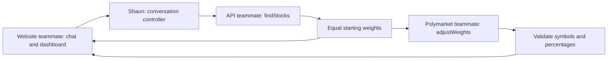

# MyETF framework and intended user flow

This is Shaun’s UI-independent application framework. It contains controller logic, replaceable services, deterministic fixtures, validation, tests, and this architecture. The website teammate implements the screens and browser navigation described below.



## Intended user flow for the website teammate

1. Chat: show MyETF and “What interests or ideas would you like your portfolio to reflect?”, one text input, and a Build my basket button. Accept free text in any language.
2. Submission: call `submitIdea(text)`. While status is `finding`, disable duplicate submissions and display “Finding stocks for your idea…”. Show inline validation or selection errors while preserving the idea for retry.
3. Dashboard: when `view` becomes `dashboard`, render stock identities, reasons, and equal starting percentages. While status is `adjusting`, display percentage-adjustment progress.
4. Completion: show starting/current weights and `adjustment.explanation`. Valid adjusted weights replace current percentages; unchanged, failed, or invalid responses retain the baseline.
5. Edit/reset: call `editIdea()` to cancel pending work, clear the basket, and preserve the idea. Call `reset()` to cancel pending work and clear the session.

The website teammate owns rendering, focus, accessibility, and responsive layout. Implement `#chat` / `#dashboard` navigation using `setView(view)`: it preserves a completed basket and refuses a dashboard without stocks. Recreate the controller on reload to start a fresh session. Browser history and URL handling are not implemented in the controller.

## Controller and services

- `js/controller.js` owns application state, transitions, cancellation, and validation. It has no DOM or network imports.
- `js/services.js` supplies mock `findStocks` and `adjustWeights` adapters. `data/chat-demo.json` contains fixtures. Replace the adapters using the [service contracts](team-contracts.md).
- The website teammate wires these modules into `js/app.js` and builds `index.html`, `css/styles.css`, and `js/ui.js`. This framework PR does not modify those existing website files.

```js
import { createController } from "../js/controller.js";
import { createMockServices } from "../js/services.js";

const controller = createController(createMockServices());
const stop = controller.subscribe(state => {
  // Website teammate: render this state with your own components.
});
const snapshot = controller.getState();
await controller.submitIdea("I care about clean energy");
controller.editIdea();
controller.reset();
controller.setView("dashboard"); // router hook; requires an existing basket
stop();
```

Snapshots contain `view`, `status`, `idea`, `summary`, `messages`, `stocks`, `startingHoldings`, `holdings`, `adjustment`, and `error`. Status is `idle`, `finding`, `adjusting`, `ready`, or `error`. Messages have `{ role: "assistant" | "user", content }`. Adjustment status is `pending`, `adjusted`, `unchanged`, or `unavailable`.

Subscriptions immediately receive a snapshot and return an unsubscribe function. Snapshots are copies; renderers must not mutate controller internals or call services directly. The controller rejects duplicate submissions while busy, aborts cancelled requests, and ignores late responses even if adapters ignore cancellation. Website renderers must display user/service strings as text rather than raw HTML.

## Mock behavior and live handoff

The mock recognizes a limited keyword set in English, Chinese, and Spanish. If multiple themes match, technology wins, then clean energy, then healthcare. Unsupported text produces an explicitly labeled generic example. Any language is accepted as input, but these mocks do not translate or understand arbitrary natural language.

Each sample basket contains three fictional companies. Theme fixtures use fixed 50% / 30% / 20% simulated adjustments without fabricated market evidence. Generic fixtures retain equal weights. These are interface examples, not stock recommendations or a Polymarket weighting methodology. The website teammate must clearly label demo results; live-mode labels should be coordinated with the API teammates.

The API teammate verifies stock symbols and holds Gemini credentials on a separate backend, following [Google’s API-key guidance](https://ai.google.dev/gemini-api/docs/api-key). The Polymarket teammate owns market matching and weighting methodology. No live API calls, trading, prices, persistence, or account system are implemented here.

Run `npm test` or `npm run demo:framework -- "I care about clean energy"` to exercise this framework without a website. The existing portfolio calculation module and tests remain independent.
