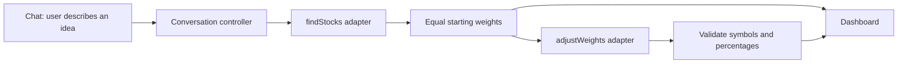

# MyETF framework and user flow

This branch implements Shaun’s framework. It is a working reference for the team, with fictional stocks and fixed demo percentages. No Google or Polymarket call is made.



## What the user sees

1. `#chat`: MyETF asks “What interests or ideas would you like your portfolio to reflect?” There is one input and a Build my basket button. Free text in any language is accepted.
2. Submission: the input and button disable while the assistant says “Finding stocks for your idea…” A blank idea shows an inline error; a failed selection keeps the idea for retry.
3. `#dashboard`: the selected companies appear with selection reasons and equal starting percentages. The weighting request runs next, with its loading state visible.
4. Valid adjusted weights replace the current percentages. An unchanged response, error, or invalid response preserves the baseline. The explanation describes what happened.
5. Edit my idea cancels pending work, clears the basket, and preserves the text. Start over cancels pending work and clears the session.

Browser Back/Forward changes screens without discarding a completed basket. A dashboard hash without a basket resolves to chat. Reload always starts a fresh session. There is no account, persistence, trading, live pricing, or multilingual AI in this framework.

## Architecture and state

- `js/controller.js` owns transitions and validation. It has no DOM or network imports. Inject `{ findStocks, adjustWeights }` using the [service contracts](team-contracts.md).
- `js/services.js` contains only mock adapters. `data/chat-demo.json` contains the theme fixtures. Replace adapters to integrate backend work.
- `js/ui.js`, `index.html`, and `css/styles.css` are the reference screens. `js/app.js` wires services, controller, rendering, and hash navigation.

Controller API:

```js
const controller = createController({ findStocks, adjustWeights });
const stop = controller.subscribe(state => render(state)); // immediate snapshot
const state = controller.getState(); // a copy, safe for the caller to inspect
await controller.submitIdea("I care about clean energy");
controller.editIdea();
controller.reset();
controller.setView("dashboard"); // optional router hook; requires an existing basket
stop();
```

Snapshots contain `view`, `status`, `idea`, `summary`, `messages`, `stocks`, `startingHoldings`, `holdings`, `adjustment`, and `error`. `status` is `idle`, `finding`, `adjusting`, `ready`, or `error`. Messages have `{ role: "assistant" | "user", content }`. Adjustment status is `pending`, `adjusted`, `unchanged`, or `unavailable`.

Subscriptions return an unsubscribe function. Renderers consume state and dispatch controller methods; they do not mutate snapshots or call services themselves. The controller rejects duplicate submissions while busy, aborts cancelled requests, and ignores late responses even when adapters ignore cancellation. Percentages are validated before display. User text and service text are rendered as text, not HTML.

## Mock behavior and live handoff

The mock recognizes a small documented set of keywords in English, Chinese, and Spanish. When multiple themes match, technology wins, then clean energy, then healthcare. Unrecognized text produces an explicitly labeled generic example rather than pretending to analyze it.

Each sample basket has three fictional companies. Theme examples use fixed 50% / 30% / 20% simulated adjustments, with no fabricated market evidence. Generic examples retain equal weights. These fixtures demonstrate interfaces, not a stock recommendation or a Polymarket weighting methodology.

The reference screens and footer are explicitly demo-labeled. Before a future live mode, the website and API teammates must add accurate source/mode labels together; changing adapters alone does not make this reference UI a live product. The API teammate’s stock adapter must verify the stock symbols it returns. Real Gemini calls require a separate backend: [Google recommends server-side API calls so keys are not exposed in the browser](https://ai.google.dev/gemini-api/docs/api-key).

The legacy portfolio calculation module and its tests remain independent. The old budget, company picker, scenario sliders, and export controls are not part of this flow.
