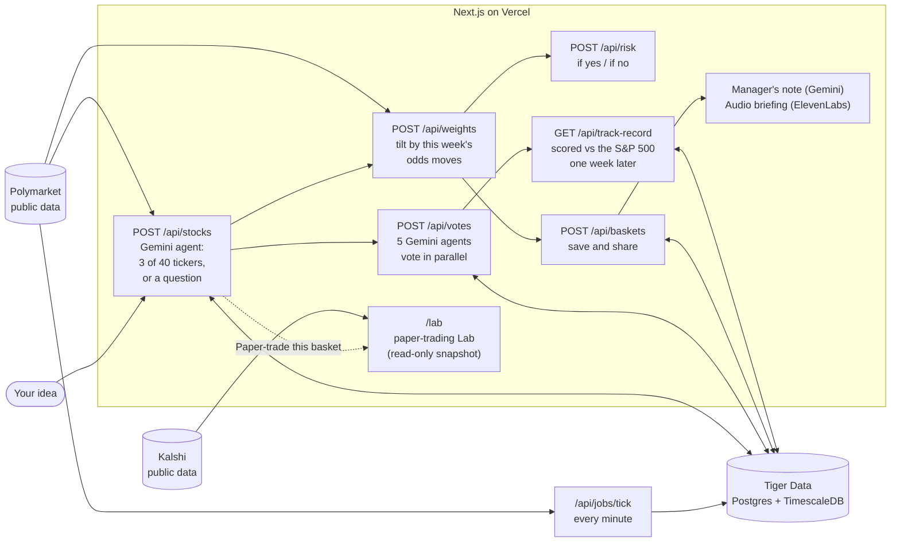

# ProphETF

**Turn an idea into a stock basket, backed by live prediction-market odds.**

Live: **https://prophetf.vercel.app**

You type an investing idea ("AI chips and Taiwan risk"). A Gemini agent picks three stocks for it, or
asks you to clarify when the idea is too broad or not covered. Live Polymarket odds tilt the weights,
five more AI agents vote on the basket, and every one of their calls is scored against the S&P 500 a
week later, in public. You can then paper-trade the basket in the Lab and test "what if this event
happens" scenarios.

Paper portfolios for research and fun. Not investment advice. Not affiliated with Polymarket or Kalshi.

This folder (`/web`) is the whole deployed app: the website and the API, one Next.js project on Vercel.

## Architecture



- **The stock agent** (`/agent` at the repository root, copied into `src/lib/agent-core` by
  `pnpm sync:agent`) is one Gemini agent with retrieval, function tools and session memory. It first
  judges the idea (clear, broad, not covered, unclear); only a clear idea gets a basket, anything else
  gets one question with two or three options. It can only pick from 40 tickers, and code checks the
  answer again.
- **Weights** (`src/lib/weights`) start equal and are tilted by how the linked Polymarket odds moved in
  the past seven days. This is a TypeScript port of Hao's Python engine in `/backend`, kept identical by
  a parity test.
- **The panel** (`src/lib/votes`) is five Gemini calls in parallel, each with its own role (Growth
  investor, Value / risk, Macro & events, Skeptic, Fit checker). Each votes on every stock and answers
  one question about the basket: will it beat the S&P 500 next week?
- **The track record** (`src/lib/track`) stores every panel decision and scores it a week later.
- **The Lab** (`/experiment` at the repository root, Shaun's work, copied in by `pnpm sync:lab`) runs
  on a committed snapshot of prices and event odds. Paper money stays in your browser.

## Pages

| Page                  | What it is                                                                                                       |
| --------------------- | ---------------------------------------------------------------------------------------------------------------- |
| `/`                   | Build: the idea box, then the basket, "Why these weights", the AI panel, and Save & share                        |
| `/b/{id}`             | The share page of a saved basket, with its manager's note and audio briefing                                     |
| `/track-record`       | How often each agent and the panel were right, with ranges, and every decision                                   |
| `/how-it-works`       | The pipeline and one card per technology with live numbers                                                       |
| `/lab`, `/lab/basket` | The paper-trading Lab: fund a basket with paper dollars and move an event's odds to see an illustrative scenario |
| `/console`            | The old backend test console, not linked, kept for debugging                                                     |

Opening a page never calls Gemini or ElevenLabs. Those run only when you submit an idea, save a basket
or press Listen.

## Endpoints

Full request and response examples: [`docs/API.md`](docs/API.md).

| Endpoint                                                                | Purpose                                                                           |
| ----------------------------------------------------------------------- | --------------------------------------------------------------------------------- |
| `POST /api/stocks`                                                      | Idea in, three stocks out, or `422 needs_clarification` with options              |
| `POST /api/weights`                                                     | Tilts a basket's weights by Polymarket odds moves                                 |
| `POST /api/risk`                                                        | The basket's estimated move if each linked event happens, or does not             |
| `POST /api/votes`                                                       | Five agents vote on each stock and on the basket                                  |
| `GET /api/track-record`                                                 | Each agent's record, the panel's, the baselines and the decisions                 |
| `GET /api/savings`                                                      | Today's answers, how many were reused, and the Gemini calls made                  |
| `POST /api/baskets`, `GET /api/baskets/{id}`                            | Save and load a basket                                                            |
| `POST /api/baskets/{id}/letter`                                         | The manager's note of a saved basket (written once)                               |
| `POST /api/baskets/{id}/narrate`, `GET /api/audio/{id}`                 | The audio briefing of a saved basket (made once)                                  |
| `GET /api/markets/{id}/history`, `GET /api/baskets/{id}/odds`           | Odds over time for a market or a basket's markets                                 |
| `GET /api/lab/overview`, `/events`, `POST /api/lab/analysis`, `/stocks` | The Lab's data and its 7 to 10 company shortlist                                  |
| `GET /api/built-with`, `GET /api/health`                                | Live proof of what is used, and the system status with Gemini budgets             |
| `POST /api/jobs/tick`                                                   | Records the odds of every tracked market (needs `CRON_SECRET`)                    |
| `POST /api/analyze`, `POST /api/decide`                                 | An earlier evidence-packet workflow, kept for debugging; the site does not use it |

## Setup

Needs Node 20 or newer and pnpm (`npm i -g pnpm`). All commands run in `/web`.

```sh
pnpm install
cp .env.example .env.local   # then fill it in
pnpm db:migrate              # creates the tables (12 migrations)
pnpm dev                     # http://localhost:3000
```

### Environment variables

| Variable                                                           | Needed for                                                                     |
| ------------------------------------------------------------------ | ------------------------------------------------------------------------------ |
| `DATABASE_URL`                                                     | Tiger Cloud connection string (Postgres + TimescaleDB), `sslmode=require`      |
| `GEMINI_API_KEY`                                                   | Google AI Studio key. No Google Cloud project needed                           |
| `CRON_SECRET`                                                      | Any long random string; protects `/api/jobs/*`                                 |
| `APP_BASE_URL`                                                     | Public URL without a trailing slash (`http://localhost:3000` locally)          |
| `FEATURE_ELEVENLABS`                                               | `true` turns the audio briefing on; otherwise the briefing is returned as text |
| `ELEVENLABS_API_KEY`, `ELEVENLABS_VOICE_ID`, `ELEVENLABS_MODEL_ID` | The ElevenLabs account, voice and model (`eleven_flash_v2_5`)                  |
| `CORS_ORIGINS` (optional)                                          | Extra origins allowed to call the API, comma-separated                         |

In production the same variables are set in Vercel. `.env.example` still lists a few variables of
features we dropped; nothing reads them. Polymarket and Kalshi need no key.

### Scripts

| Command                                    | What it does                                                                              |
| ------------------------------------------ | ----------------------------------------------------------------------------------------- |
| `pnpm dev`, `pnpm build`, `pnpm start`     | Run or build the app. `build` first runs the two sync scripts below                       |
| `pnpm test`, `pnpm typecheck`, `pnpm lint` | Tests (Gemini, ElevenLabs and Polymarket are mocked), types, lint                         |
| `pnpm db:migrate`, `pnpm db:status`        | Apply or list the SQL migrations in `db/migrations`                                       |
| `pnpm sync:agent`, `pnpm sync:lab`         | Copy `/agent` and `/experiment` into this app (Vercel only receives `/web`)               |
| `pnpm jobs:loop`                           | Calls the tick job every minute against a local server                                    |
| `pnpm track:daily`                         | Loads the last 14 days of stock closes, then scores every decision that is a week old     |
| `pnpm demo:warm`                           | Runs the example ideas once so they are answered from the cache; `--loop` keeps them warm |
| `pnpm parity:weights`                      | Regenerates the fixture that proves the weights port matches the Python engine            |
| `pnpm try:clarify`, `pnpm eval:decider`    | Live checks against Gemini. They spend quota: read `CLAUDE.md` first                      |

The tests of the agent and of the teammates' code run at the repository root: `npm test`.

### The jobs

- **Every minute: the odds tick.** Schedule `https://<your-app>/api/jobs/tick` on
  [cron-job.org](https://cron-job.org) every minute, method `POST` (or `GET`), with the header
  `Authorization: Bearer <CRON_SECRET>`. It stores one odds reading per tracked market and is safe to
  run twice.
- **Once a day: `pnpm track:daily`.** Run it on a machine with Python, because prices come from Yahoo
  Finance through `yfinance`: `python -m venv .venv-closes`, then
  `.venv-closes/Scripts/pip install yfinance` (or set `CLOSES_PYTHON` to another Python). Nothing on
  Vercel fetches prices.
- **Before a demo: `pnpm demo:warm`.** An answer that rests on Polymarket odds stays cached for up to
  24 hours while those odds stay within 3 points.

### Deploy

`npx vercel --prod --yes` from `/web`. Add each environment variable once with
`npx vercel env add NAME production`.

## Built with

**In the product**

| Technology                 | What it does here                                                                     |
| -------------------------- | ------------------------------------------------------------------------------------- |
| Google Gemini              | The stock agent, the five-agent voting panel and the manager's note                   |
| Tiger Data                 | Postgres + TimescaleDB for odds readings, stock closes, panel decisions and all state |
| Polymarket and Kalshi data | Read-only public odds, no keys                                                        |
| Stock prices               | Daily closes from Yahoo Finance, loaded with Hao's Python code (`pnpm track:daily`)   |
| ElevenLabs                 | The audio briefing of a saved basket (Listen on `/b/{id}`)                            |

**How we built and run it**

| Tool                      | What for                                                                 |
| ------------------------- | ------------------------------------------------------------------------ |
| Claude Code               | Wrote and tested the backend, the agent, the panel and the website       |
| Vercel                    | Hosting for the website and the API, deployed from the CLI               |
| cron-job.org              | Calls `/api/jobs/tick` every minute                                      |
| GitHub and GitHub Actions | The repository, and CI that runs every part's tests on each pull request |
| Next.js and TypeScript    | The website and the API routes                                           |
| Python                    | Hao's research and the weighting method (`/backend`)                     |

The How it works page shows the same two groups with live numbers (ElevenLabs has no card there).

## Google Gemini

Every AI answer comes from the Gemini API, on the free tier: plain REST from the stock agent, the `@google/genai` SDK for the panel and the manager's note.

- **The stock agent** uses function calling (`check_selection`, `get_memory`, `remember_preference`,
  `google_search`) together with structured JSON output. The answer schema starts with `clarity`, so
  the model judges the idea before it writes a ticker, and the server refuses a basket unless the idea
  is clear.
- **The voting panel** is five parallel calls on two Flash-Lite models.
- **The manager's note** of a saved basket is one call on a Flash model; every percentage in it is
  checked against the basket before it is shown.
- **Quota:** each model has a budget at 80% of its free limit, counted in the database, with a
  fallback chain per task (`src/lib/gemini/models.ts`). A new idea costs 7 Flash-Lite calls (2 for the
  pick, 5 for the panel). An answer is reused for everyone until a Polymarket market it cites moves 3
  points, so most repeat ideas cost nothing. `GET /api/savings` shows today's numbers.

## Tiger Data

One Tiger Cloud service (Postgres 18, TimescaleDB) holds everything.

- `odds_ticks` is a hypertable with a columnstore policy; `odds_1h` is a continuous aggregate over it.
  Charts read both with `time_bucket_gapfill` and `locf`.
- `stock_closes`, `panel_decisions` and `panel_votes` make the track record plain SQL: who was right,
  how often, against what.
- The rest of the app's state is there too: saved baskets, the audio briefings (as `bytea`), response
  caches, rate limits, per-model Gemini budgets and the agent's session memory.
- `GET /api/built-with` returns live row counts, the latest tick and query timings.

## ElevenLabs

When you press **Listen** on a saved basket, the manager's note is turned into a spoken briefing of
about a minute (`eleven_flash_v2_5`): tickers are spoken as company names and weights are rounded. The
MP3 is stored in Tiger and served from `/api/audio/{id}`, so each basket is narrated once. If
ElevenLabs is off or over budget, the briefing is shown as text instead.

## Polymarket and Kalshi data

Read-only public data. No keys, no accounts, no wallets, no orders.

- **Polymarket:** live odds and odds history from the public Gamma and Data APIs. They ground the
  agent's pick, tilt the weights, feed the event-risk numbers and are recorded every minute.
- **Kalshi:** public market data for seven topics, used only in the Lab's committed snapshot.
- Event probabilities indicate risk, not expected returns. Our own research says the same: see
  `backend/research/METHODOLOGY.md`.

## Team

| Who    | What                                                                   |
| ------ | ---------------------------------------------------------------------- |
| Lucas  | Backend, the AI agent, the voting panel, the track record, the website |
| Hao    | Polymarket weighting research and weights, event risk                  |
| Shaun  | The framework and the paper-trading Lab                                |
| Kieran | Website design                                                         |
