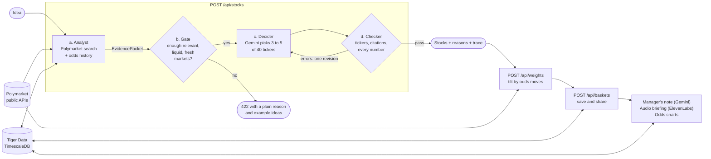

# ProphETF backend

Type an investing idea, get a small stock basket whose every pick is explained by live prediction-market
odds, weighted by how those odds moved, and saved with the odds behind it tracked over time.

This folder (`/web`) is the backend: a Next.js app with API routes only, deployed at
**https://prophetf.vercel.app**. The website lives at the repository root and is a teammate's work; it talks
to this backend through three small adapters (`/js/stocks-adapter.js`, `/js/weights-adapter.js`,
`/js/baskets-adapter.js`).

Paper portfolios for research and fun. Not investment advice. Not affiliated with Polymarket.

## What it uses

| Technology          | What it does here                                                                                                                                                                            |
| ------------------- | -------------------------------------------------------------------------------------------------------------------------------------------------------------------------------------------- |
| **Google Gemini**   | Plans the Polymarket searches for an idea, makes the final stock decision with a reason per stock, and writes the manager's note of a saved basket                                           |
| **Tiger Data**      | Postgres + TimescaleDB for everything stored: the odds history (hypertable, columnstore, continuous aggregate, gap-filled chart queries), baskets, caches, rate limits, model budgets, audio |
| **ElevenLabs**      | Reads the manager's note aloud as a one-minute audio briefing                                                                                                                                |
| **Polymarket data** | The evidence: live markets, odds and odds history from Polymarket's public read-only APIs. No trading, no keys, no wallets                                                                   |

## How an idea becomes a basket

`POST /api/stocks` is a fixed four-stage workflow, not an autonomous agent. Each stage is one small function
in `src/lib/pipeline/`, and the response carries a `trace` with one line per stage.



- **Analyst** collects markets and analyzes them into an evidence packet (`src/lib/analyst/packet.ts`). The
  built-in one asks Gemini for search queries, searches Polymarket, links markets to tickers and reads odds
  changes from Tiger. A teammate's analyst can replace it without touching anything else
  (`docs/HANDOFF.md`).
- **Gate** is plain code. Fewer than two relevant, liquid, open markets means no Gemini call and an honest
  "not enough evidence" answer.
- **Decider** is one Gemini call with structured JSON output. Its only source of facts is the packet.
- **Checker** is plain code: allowed tickers, 3 to 5 unique stocks, every cited market exists in the packet,
  every percentage matches the packet within one point. On errors the decider gets exactly one revision.

If Gemini is unavailable or over budget, the answer comes from the evidence alone in the same shape; nobody
sees an error for it.

## Endpoints

Full reference with request and response examples: [`docs/API.md`](docs/API.md).

| Endpoint                                                      | Purpose                                                               |
| ------------------------------------------------------------- | --------------------------------------------------------------------- |
| `POST /api/stocks`                                            | Idea → 3 to 5 stocks with reasons that cite live Polymarket odds      |
| `POST /api/analyze`, `POST /api/decide`                       | The two halves of the workflow on their own, for testing              |
| `POST /api/weights`                                           | Holdings → weights tilted by Polymarket odds moves, with the evidence |
| `POST /api/baskets`, `GET /api/baskets/{id}`                  | Save a basket and open it again by its short id                       |
| `GET /api/baskets/{id}/odds`, `GET /api/markets/{id}/history` | Odds history for charts (1 day, 7 days, 30 days)                      |
| `POST /api/baskets/{id}/letter`                               | The manager's note, written by Gemini                                 |
| `POST /api/baskets/{id}/narrate`, `GET /api/audio/{id}`       | The note as an MP3 briefing                                           |
| `GET /api/built-with`                                         | Live proof of each technology: row counts, query times, briefings     |
| `GET /api/health`                                             | Database status and what is left of each Gemini model's daily budget  |

## How each technology is used

### Google Gemini

- Called directly with `@google/genai` and an API key; structured JSON output on every call.
- **Search plan** (`src/lib/analyst/plan.ts`): one call turns the idea into 3 to 6 Polymarket search queries
  and the sectors it touches, cached for a day.
- **Decision** (`src/lib/pipeline/decider.ts`): one call picks the stocks and writes the reasons; one more
  only if the checker rejects the answer.
- **Manager's note** (`src/lib/letter/`): a short letter for a saved basket; its numbers are checked against
  the basket before it is shown.
- **Quota without billing** (`src/lib/gemini/`): one file lists the models, their free-tier limits and the
  fallback order per task. Each model may use 80% of its per-minute and per-day limit, counted in Tiger;
  a rate-limited model is skipped until its quota resets.
- **Eval** (`pnpm eval:decider`): 10 fixed ideas with fixed evidence packets, scored on the checker's rules
  and on whether every number is grounded. Run before and after every prompt change.

### Tiger Data (Postgres + TimescaleDB)

- `odds_ticks` is a **hypertable** of every Polymarket probability the app observes, with the
  **columnstore** on chunks older than a day (segmented by market).
- `odds_1h` is a **continuous aggregate** (hourly open, high, low, close) with a refresh policy.
- Charts are one query for any number of markets: `time_bucket_gapfill` with `locf` gives every market the
  same time axis. Day charts read the raw ticks, week and month charts the aggregate.
- A one-minute job records the odds of every market a saved basket cites; history is backfilled from
  Polymarket the first time a market is seen.
- Also in Tiger: baskets, the shared response cache, rate limits, per-model Gemini budgets, and the MP3
  briefings (`bytea`).
- `GET /api/built-with` returns the live numbers: rows, chunks, policy jobs and query latencies.

### ElevenLabs

- `POST /api/baskets/{id}/narrate` turns the manager's note into a spoken script (company names instead of
  tickers, rounded weights) and sends it to text-to-speech (`eleven_flash_v2_5`).
- One MP3 per basket, stored in Tiger and served with range support so players can seek.
- Behind a flag with a script-only fallback and a daily budget.

### Polymarket data

- Read-only and public: Gamma (`/public-search`, `/markets`) for markets and prices, the Data API
  (`/v2/prices-history`) for history. No auth, no order or trading endpoints.
- A market's odds are its midpoint, or the last trade when the spread is wide. Resolved, never-traded and
  illiquid markets are not used as evidence.

## Run it locally

Requirements: Node.js 22+, pnpm, a Tiger Cloud (or any TimescaleDB) database, a Gemini API key.

```sh
cd web
pnpm install
cp .env.example .env.local   # then fill in DATABASE_URL and GEMINI_API_KEY (PowerShell: Copy-Item)
pnpm db:migrate
pnpm dev                     # http://localhost:3000/api/health
```

| Command                       | What it does                                                      |
| ----------------------------- | ----------------------------------------------------------------- |
| `pnpm test`                   | Unit and contract tests (Gemini and Polymarket mocked)            |
| `pnpm lint`, `pnpm typecheck` | Static checks                                                     |
| `pnpm try:findstocks "idea"`  | The workflow against live services, with the trace                |
| `pnpm eval:decider`           | The decider eval (9 Gemini calls on the Flash-Lite models)        |
| `pnpm demo:warm --loop`       | Keeps the demo ideas cached on the deployed backend               |
| `pnpm jobs:loop`              | Runs the one-minute odds job locally                              |
| `pnpm parity:weights`         | Replays requests through the Python weighting engine and compares |

Optional: `ELEVENLABS_API_KEY`, `ELEVENLABS_VOICE_ID` and `FEATURE_ELEVENLABS=true` for audio; `CRON_SECRET`
for the job endpoints. Deploys go through the Vercel CLI: `npx vercel --prod` from `/web`.

## Layout

```
web/
  src/app/api/        route handlers (thin)
  src/lib/pipeline/   gate, decider prompt, checker, the workflow, eval cases
  src/lib/analyst/    evidence packet contract, built-in analyst, hooks for the real one
  src/lib/gemini/     models, fallback chains, per-model budgets
  src/lib/odds/       odds history: SQL, recording, backfill, the one-minute job
  src/lib/weights/    TypeScript port of the Python weighting engine in /backend
  src/lib/baskets/    saved baskets
  src/lib/letter/     manager's note        src/lib/narrate/  audio briefing
  db/migrations/      plain SQL, run by `pnpm db:migrate`
  docs/               API.md, HANDOFF.md, DEMO.md, PLAN.md
```

The weighting method itself (`POST /api/weights`) is a teammate's research and lives in `/backend` (Python);
this app runs a TypeScript port, checked by replaying 88 recorded requests through the Python engine.
